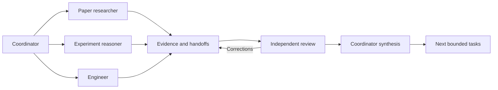

# Research coordination harness

## Purpose

Coordinate several AI agents researching compressed training images and neural dictionary learning. This harness separates paper evidence, experimental reasoning, engineering, independent review, and synthesis while preserving the user's three-person/month-long project scope.

It uses Python's standard library and a local SQLite database. No API key, model package, or background service is needed for coordination. Agents use their own host's browsing and reasoning tools. A coordinator can delegate through the host's native subagent tools; an independent agent can join by reading the same files and running the CLI.

## Layout

```text
Final Project/
  AGENTS.md                         shared agent instructions
  projectIdea.md                     historical context (preserved)
  AI360_Project_Proposal_Template.*  existing course files (preserved)
  references.bib                    existing bibliography (preserved)
  ai_harness/
    START_HERE.md                    ready-to-use prompts
    README.md                        protocol and commands
    DECISIONS.md                     current requirements and open choices
    RESEARCH_STATUS.md               coordinator's synthesis of actual handoffs
    harness.py                      executable local task ledger
    test_harness.py                 coordination checks
    tasks.json                      initial task definitions
    roles/                          coordinator, literature, reasoning,
                                    engineer, reviewer
    templates/                      paper note, experiment, handoff, review
    artifacts/<TASK-ID>/             each task's exclusive work area
    state.sqlite3                   live task/event ledger
    BOARD.md                        generated readable snapshot
    state.snapshot.json             generated machine-readable snapshot
```

## Start

Commands below run from `Final Project`. Windows has `py`; on another system use the appropriate Python 3 command. Python 3.10+ is the intended baseline. Local CLI checks used Python 3.13; the full test run used the launcher's Python 3.14 outside restricted temporary-folder access. See [VALIDATION.md](VALIDATION.md).

```powershell
py ai_harness/harness.py init
py ai_harness/harness.py status
py ai_harness/harness.py check
```

`init` is idempotent: it seeds missing tasks without resetting existing claims or results. `tasks.json` is a bootstrap definition, not the live task board. Use `add` for future work.

## The collaboration cycle



1. The coordinator checks current context and divides independent questions into tasks with non-overlapping write paths.
2. Workers atomically claim tasks. Dependencies must be accepted before a task can be claimed.
3. Workers read task packets, research/reason/implement within scope, and save durable artifacts.
4. Workers submit artifacts with hashes. A different agent reviews the evidence, not just the summary.
5. Acceptance marks the task done and unlocks dependents. Revisions return it to its author.
6. The coordinator integrates accepted reports and refreshes snapshots. The user sees findings and genuine decisions needed, not repetitive requests for routine permission.

The first literature and reasoning workers were explicitly assigned exclusive directories during harness construction before the ledger existed. The coordinator records those bootstrap claims before submission. Future tasks use ordinary claim-before-write coordination.

## Example worker workflow

Replace the example task and agent with a **pending** task and a unique session identity:

```powershell
py ai_harness/harness.py show REPRO-001
py ai_harness/harness.py claim REPRO-001 --agent engineer-a --role engineer
py ai_harness/harness.py packet REPRO-001
```

Write the assigned report, then:

```powershell
py ai_harness/harness.py heartbeat REPRO-001 --agent engineer-a
py ai_harness/harness.py submit REPRO-001 --agent engineer-a --artifact ai_harness/artifacts/REPRO-001/report.md --summary "Audited implementation options and documented unresolved dependencies."
```

Use repeated `--artifact` arguments to submit every substantive deliverable, such as a report plus evidence JSON. The CLI checks ownership, scope, file existence, nonempty content, and records hashes. It does not determine scientific correctness; the reviewer must do that.

The worker must not edit submitted artifacts during review. The `review` state retains ownership of the assigned paths. A changed submitted file fails hash verification and must be explicitly recovered/resubmitted if it was changed outside the proper revision workflow.

## Review

An independent agent reads the submitted artifacts, checks source access/claims and the task's acceptance criteria, and records a decision:

```powershell
py ai_harness/harness.py review REPRO-001 --agent reviewer-a --verdict accept --note "Checked the cited upstream code and access limitations; comparison and unresolved installation risks are accurately separated."
```

Or request correction:

```powershell
py ai_harness/harness.py review REPRO-001 --agent reviewer-a --verdict revise --note "Separate source inspection from executed verification and document the license actually observed."
```

For a substantial critique, save an independently assigned review report and mention its path in the review note. Authors cannot accept their own task under the same agent ID. Identities are cooperative labels, not cryptographic proof of separate humans/models; deliberately changing your name does not make self-review independent.

## Status, artifacts, and recovery

```powershell
py ai_harness/harness.py status --format json
py ai_harness/harness.py status --format markdown
py ai_harness/harness.py snapshot
py ai_harness/harness.py check
```

States are `pending → active → review → done`; an active task may be `blocked`. A revision returns a submitted task to `active`. Active/review/blocked tasks reserve their write scopes. A heartbeat older than 30 minutes is informative, not permission to overwrite work.

An owner can document a blockage or release unfinished work:

```powershell
py ai_harness/harness.py block REPRO-001 --agent engineer-a --reason "Full implementation unavailable; recorded accessible evidence and exact remaining question."
py ai_harness/harness.py release REPRO-001 --agent engineer-a --reason "Leaving a complete partial handoff for another worker."
```

If an agent disappears, first confirm it has stopped or interrupt it through its host. A coordinator can then recover the task with a reason:

```powershell
py ai_harness/harness.py recover REPRO-001 --agent coordinator-a --reason "Previous writer stopped; preserved partial report and reassigning remaining checks."
```

Recovery changes ledger ownership; it **does not terminate an AI process** or delete partial files. The replacement worker inspects preserved work before editing. Do not recover a task while its original worker may still write.

## Add a task

Prepare a JSON object with a unique ID, role, dependencies, exclusive write scope, and observable acceptance criteria:

```json
{
  "id": "LIT-002",
  "title": "Resolve the remaining dictionary-size overlap",
  "role": "literature",
  "description": "Inspect the full experimental section of the closest unresolved paper, or document the actual access limit and narrower supported conclusion.",
  "depends_on": ["LIT-001"],
  "write_paths": ["ai_harness/artifacts/LIT-002"],
  "acceptance": [
    "Primary source and inspected section recorded",
    "Confirmed overlap separated from unanswered questions",
    "No novelty claim from failed access"
  ]
}
```

Then run `py ai_harness/harness.py add --spec path/to/task.json`. The file is input data, not an executable command. Prefer task-local reports. Assign existing shared files only when an actual integration task needs them. Task IDs must also be unique ignoring case, and scopes cannot include generated coordination state. The CLI rejects overlapping scopes for simultaneous writers, but all agents must honor scopes during ordinary editor/shell work: this is coordination, not an operating-system sandbox.

## What each role returns

| Role | Output | Handoff |
| --- | --- | --- |
| Literature | Source matrix, inspected sections, access limits, overlap assessment | Gives reasoner evidence boundaries and reviewer citations |
| Reasoning | Testable hypothesis, controls, minimum experiment, feasibility | Gives engineer a bounded implementable plan |
| Engineer | Code audit or actual reproducible pilot artifacts, depending on scope | Gives reviewer evidence of what ran and what did not |
| Reviewer | Findings with severity, evidence, and concrete corrections | Gives coordinator an independent assessment |
| Coordinator | Integrated recommendation, decisions with provenance, next tasks | Keeps the user and future agents aligned |

Separate files per task avoid concurrent edits to one giant paper list. The coordinator links accepted evidence and updates shared decisions. Structured paper records can follow `templates/paper_note.md`; report structure can follow `templates/handoff.md`. Templates guide content, while CLI validation only checks ledger/ownership/artifact integrity.

## Scientific acceptance criteria

- Scope stays on stored **training** data, not only compressed-input robustness.
- Full-file storage, payload-only bpp, JPEG quality factor, and raw/reference compression ratios remain distinct.
- Native dimensions and dataset sample identities are controlled.
- Neural dictionary behavior is explicit; available M and active k are separated.
- The baseline gets a fair compression-training/pretraining/tuning budget.
- No clean targets or cached features are hidden in a compressed-only training claim.
- Hypotheses and proposed thresholds are not reported as outcomes.
- Evidence has inspectable sources or saved run artifacts; unavailable papers remain unresolved.
- Negative results are valid findings.

## Local concurrency and portability

SQLite serializes local mutations and records an event history. Dependency checks and ownership changes occur transactionally. Relative task scopes are resolved beneath the project root; the test suite covers conflicting claims and path/ownership failures.

Use multiple agents against **one local copy on one computer**. This project lives in OneDrive, but independently opening synced database replicas on different computers is not supported. For remote collaborators, keep a single ledger coordinator and exchange task packets/artifacts; do not merge live SQLite files. `snapshot` provides readable exports for handoff, not automatic database restoration. The database is local state; back it up only while no writer is active. If deliberately starting a new ledger, reconcile prior reviewed artifacts explicitly rather than assuming seed tasks retain past completion.

For isolated testing use the global `--root` option before the subcommand with a temporary project root. The CLI must be initialized there with a seed before use. Production reports are never used as test scratch space.

```powershell
py -m unittest discover -s ai_harness -p test_harness.py -v
```

## Design reference

The shared `AGENTS.md` plus task/context files follow the general repository-guidance convention described in [OpenAI's workflow documentation](https://developers.openai.com/cookbook/examples/codex/iterating-development-workflows-with-codex). The SQLite queue, role definitions, scientific checks, and workflows here are local project-specific implementation, not built-in Codex capabilities. No OpenAI API integration or automatic background scheduler is configured.
